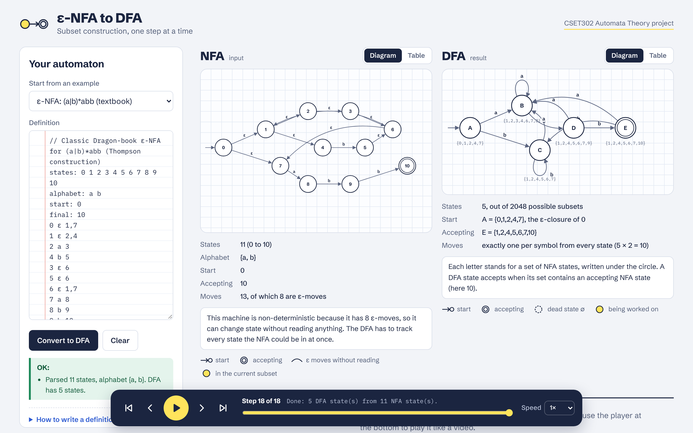

# ε-NFA → DFA Conversion Simulator · Group `__`

> CSET302 – Automata Theory and Computability · Bennett University · Simulator Design Project (Milestone-II)

An interactive web simulator that converts any **ε-NFA / NFA into an equivalent DFA** using the **subset (powerset) construction**, shows **every ε-closure and move step**, and **proves the result is correct** by running strings through both machines.

**Live demo:** `https://<github-username>.github.io/nfa-dfa-simulator/` *(enabled by the GitHub Pages workflow)*



---

## Overview: what does the simulator do?

1. You type (or load) an ε-NFA: states, alphabet, start, final states, transitions.
2. The simulator validates it, draws the NFA, and runs subset construction.
3. A media-player bar at the bottom (rewind, back, play/pause, forward, skip to end, scrubber, speed) steps through the algorithm one computation at a time. The DFA diagram and transition table **grow live**, and the NFA states inside the current subset are marked with a highlighter.
4. You get the final DFA (graph + table), and can test strings on **both** machines with an animated trace.
5. Validation: an automatic equivalence check on *all* strings up to length *n*, plus a test-case table (expected vs actual, Pass/Fail).

User input → Algorithm → Step-by-step visualisation → Result → Validation.

## Supported features

| Feature | Details |
|---|---|
| Dynamic input | Any ε-NFA/NFA in a simple text format; 5 built-in examples |
| ε-moves | `ε`, `eps`, `epsilon`, `#`, `λ` are all accepted as epsilon |
| ε-closure | Iterative DFS, handles ε-cycles |
| Subset construction | Generates only reachable subsets; explicit dead state `∅` so the DFA is **complete** |
| Step player | Fixed bottom bar: rewind, back, play/pause, forward, skip to end, scrubber, 0.5×/1×/2× speed; keys ← → Home End Space |
| Clickable steps | Every step is listed (grouped by DFA state) and clickable, and each one is explained in plain English: what move gave, what the ε-closure added, and whether a new DFA state was created |
| Tables | Diagram / Table switch on both sheets: NFA transition table with the ε-closure of every state; full DFA table with the subset behind each letter; plus the DFA table growing step by step |
| About this diagram | Info card under each diagram: counts, start/accepting states, ε-moves, *why* the NFA is non-deterministic, what each DFA letter stands for, legend |
| Visualisation | NFA and DFA side by side on graph paper; auto-laid-out SVG state diagrams (start arrow, double-circle finals, self-loops, dashed dead state, highlighted current step) |
| String testing | NFA trace (set of active states) and DFA trace (single state) side by side, with animation |
| Validation | Exhaustive equivalence check + batch test cases with Pass/Fail |
| Error handling | Unknown states/symbols, missing start, malformed lines, multi-char symbols, reserved ε names; warnings for unreachable states and empty language |
| Export | Download the DFA as a text definition (re-loadable) |

## Technology stack and dependencies

| Component | Version |
|---|---|
| HTML5 / CSS3 / JavaScript (ES2017) | runs in any modern browser (Chrome, Edge, Firefox, Safari) |
| Node.js (tests only) | ≥ 18 (uses built-in `node:test`, no npm packages) |
| GitHub Actions | CI tests + GitHub Pages deploy |

**No external libraries.** The graph renderer (`render.js`) is written from scratch in SVG, and the fonts (Schibsted Grotesk, IBM Plex Mono; SIL Open Font License) are bundled in `SourceCode/fonts/`, so the simulator works fully offline.

## Installation

```bash
git clone https://github.com/<github-username>/nfa-dfa-simulator.git
cd nfa-dfa-simulator
```

That's it. There is nothing to install for the simulator itself.

## How to run

- **Easiest:** open `SourceCode/index.html` in a browser (double-click).
- **Local server (optional):** `npm start` → opens http://localhost:8080
- **Online:** the live demo link above.

Entry point: `SourceCode/index.html` → loads the core modules in `js/automata/`, the renderer `js/render.js`, then the UI panels in `js/app/` (`main.js` last).

## Example

Input (strings over {0,1} ending in `01`):

```
states: q0 q1 q2
alphabet: 0 1
start: q0
final: q2
q0 0 q0,q1
q0 1 q0
q1 1 q2
```

Output DFA:

| DFA state | NFA states | 0 | 1 |
|---|---|---|---|
| →A | {q0} | B | A |
| B | {q0,q1} | B | C |
| *C | {q0,q2} | B | A |

`101` → accepted (A → B → C), `110` → rejected (A → A → A → B).

## Project structure

```
nfa-dfa-simulator/
├── SourceCode/
│   ├── index.html              # UI layout (entry point)
│   ├── css/style.css           # styling (lab-notebook theme)
│   ├── fonts/                  # bundled web fonts + licences
│   └── js/
│       ├── automata/           # CORE LOGIC: pure functions, no DOM (also run by Node tests)
│       │   ├── closure.js      # constants, state-set naming, ε-closure, move
│       │   ├── parser.js       # text definition → NFA object, validation + error messages
│       │   ├── examples.js     # built-in example automata
│       │   ├── subset.js       # subset construction + step log
│       │   ├── simulate.js     # run strings on the NFA and on the DFA (with traces)
│       │   └── validate.js     # exhaustive equivalence check, table export
│       ├── render.js           # SVG state-diagram renderer (layout, edges, self-loops, highlighting)
│       └── app/                # UI PANELS: each module subscribes to App events
│           ├── state.js        # shared state, helpers, event bus (init / converted / reset)
│           ├── input.js        # definition editor, examples, NFA diagram/table + info card
│           ├── dfa-view.js     # DFA graph + table builders (full or partial)
│           ├── steps.js        # step player bar, clickable step list, plain-English explanations
│           ├── result.js       # DFA table, info card, summary, export
│           ├── trace.js        # string tester with slow-motion trace
│           ├── validation.js   # equivalence check + test cases
│           └── main.js         # entry: fires init, loads first example
├── TestCases/
│   ├── parser.test.js          # T05, T06, T18, T19
│   ├── subset.test.js          # T07, T08, T14, T16, T17
│   ├── simulate.test.js        # T01–T04, T09, T11–T13, T15
│   ├── equivalence.test.js     # T10
│   └── test-cases.md           # test plan: inputs, expected vs actual results
├── Screenshots/                # screenshots used in the report
├── Report/                     # technical report (PDF + DOCX)
├── .github/workflows/ci.yml    # run tests on every PR + deploy to GitHub Pages
├── package.json                # npm test / npm start
└── LICENSE
```

**Design:** the UI panels never call each other directly. `input.js` parses and converts, then emits `converted`, and every panel redraws itself. This means each panel is an independent module that can be developed, reviewed and tested on its own.

### Key functions (core)

| Function | File | Purpose |
|---|---|---|
| `parseNFA(text)` | parser.js | Parse + validate the definition → `{nfa, errors, warnings}` |
| `epsilonClosure(nfa, T)` | closure.js | All states reachable from T using only ε-moves |
| `move(nfa, T, a)` | closure.js | States reachable from T on one `a`-transition |
| `subsetConstruction(nfa)` | subset.js | Builds the DFA + a step log for visualisation |
| `simulateNFA / simulateDFA` | simulate.js | Run a string, return accept/reject + trace |
| `checkEquivalence(nfa, dfa, n)` | validate.js | Compare both machines on every string of length ≤ n |

Documented behaviour:
- **Incomplete DFAs:** never assumed. If `ε-closure(move(T,a)) = ∅`, the dead state `∅` is created explicitly with self-loops.
- **Alphabet validation:** every input symbol is checked; unknown symbols give an error instead of a silent reject.
- **ε input:** the empty string is accepted iff `ε-closure({q0})` contains a final state.

## Testing

```bash
npm test          # or: node --test TestCases/*.test.js
```

Expected output: `# pass 19  # fail 0`. Tests cover normal accept/reject, invalid symbols, ε, malformed definitions, the textbook (a|b)\*abb DFA (Aho et al.), exponential blow-up (8 states), the dead state, ε-cycles, unreachable states, and NFA/DFA equivalence on all strings up to length 8. Tests T16–T19 cover the step log, the exact 3-state DFA for "ending in 01", the serialise/parse round-trip and duplicate-state handling. The full test plan is in [`TestCases/test-cases.md`](TestCases/test-cases.md). Tests run automatically on every push and pull request via GitHub Actions.

## Known limitations and troubleshooting

- Alphabet symbols must be single characters (e.g. `a`, `0`), and state names must not contain spaces or commas.
- The DFA is **not minimised**. Minimisation is a separate topic (and a future enhancement).
- Very large NFAs (> ~15 states) can produce up to 2ⁿ DFA states, so the diagram becomes crowded. The table stays readable.
- The equivalence check caps out at 20,000 strings and lowers *n* automatically for large alphabets.
- *Nothing happens on Convert?* Check the red error box: it names the line number that has the problem.

## Team contributions and acknowledgements

Every feature was built on its own branch and merged through a reviewed pull request (see the repo's **Pull requests** tab and commit history).

| Member | Code | Tests / docs |
|---|---|---|
| Suhani Nagwani | `render.js`; UI framework `app/state.js`, `input.js`, `main.js`; step player `steps.js`, `dfa-view.js`, `result.js`; **string simulation core** `automata/simulate.js`; string tester `trace.js`; CI/CD + GitHub Pages | `simulate.test.js`, README |
| Sriraga | **Core algorithms** `automata/closure.js`, `parser.js`, `examples.js`, `subset.js`, `validate.js`; validation panel `app/validation.js` | `parser.test.js`, `subset.test.js`, `equivalence.test.js`, test plan, screenshots, report |
| _Member 3_ | _fill in_ | |
| _Member 4_ | _fill in_ | |
| _Member 5_ | _fill in_ | |

Reference: A. V. Aho, M. S. Lam, R. Sethi, J. D. Ullman, *Compilers: Principles, Techniques, and Tools*, 2nd ed., §3.7 (subset construction, Fig. 3.34–3.36); J. E. Hopcroft, R. Motwani, J. D. Ullman, *Introduction to Automata Theory, Languages, and Computation*, 3rd ed., §2.3–2.5. The textbook example was cross-checked against the hand-worked trace in the report (optionally also verify in JFLAP).

Licensed under the MIT License.
